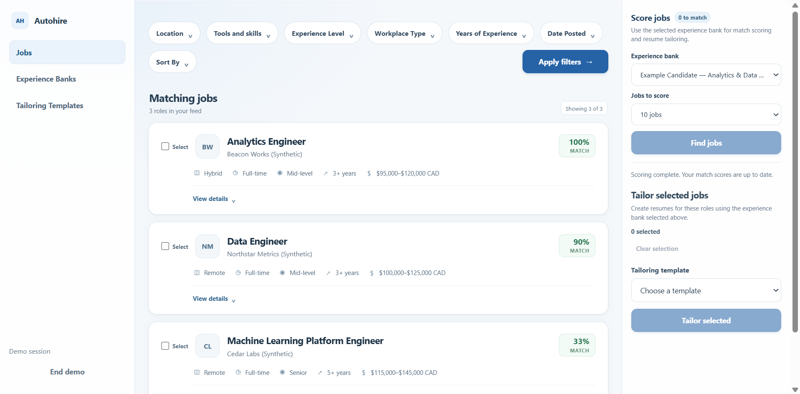
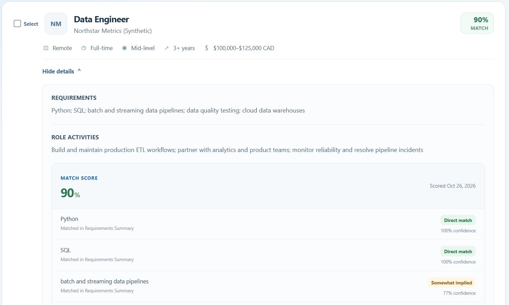
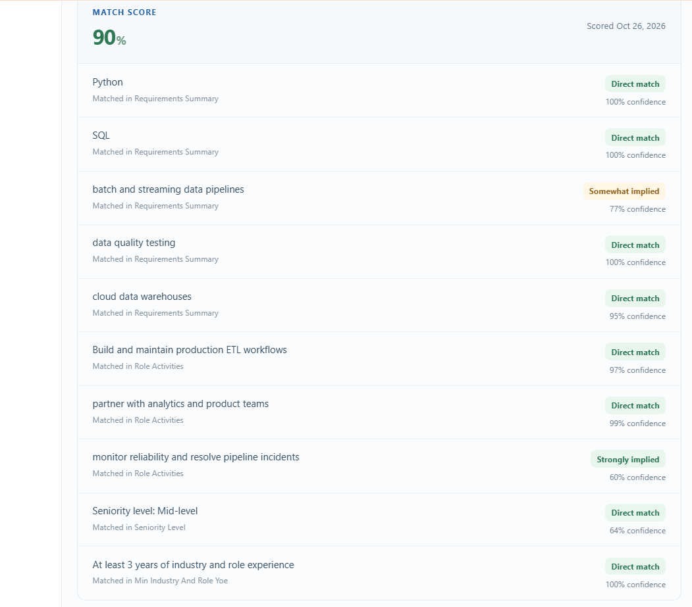
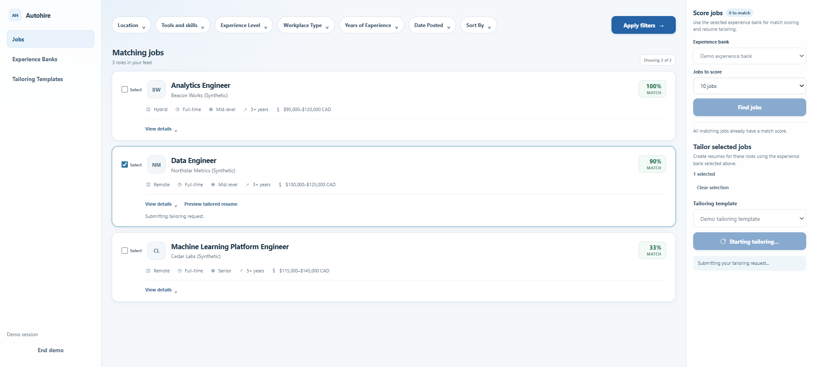
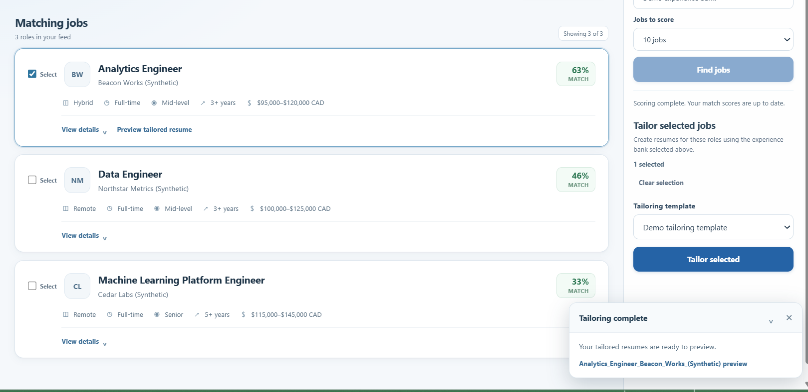
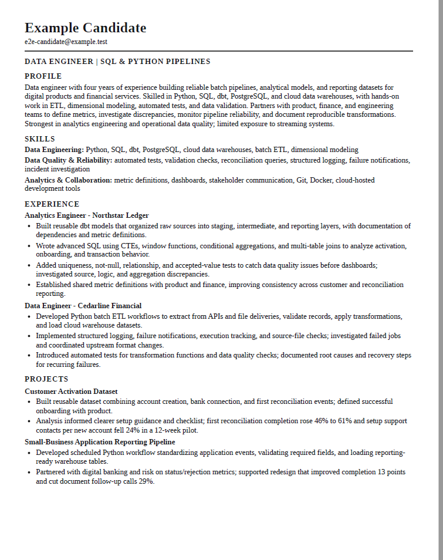
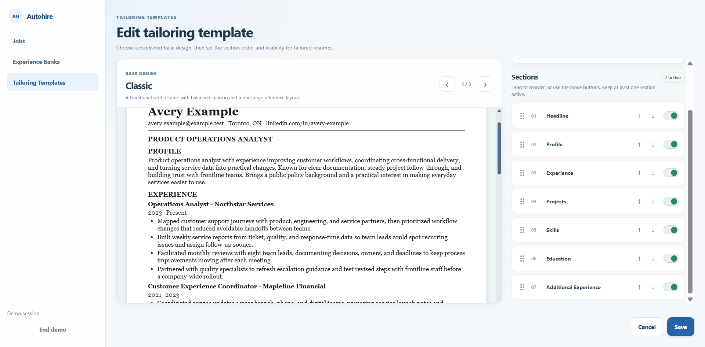
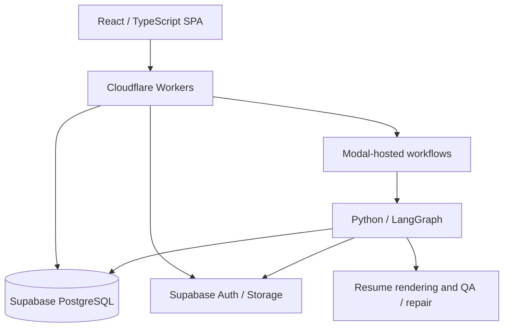

# AutoHire

**A full-stack job-search and resume-tailoring application built around explainable job matching, reusable candidate experience, and asynchronous AI workflows.**

AutoHire brings job discovery, requirement-level fit analysis, configurable resume generation, and PDF preview into one workflow. The demo uses **fictional employers, job postings, and candidate data**.

> **Live demo:** Production demo link coming soon. The source code is maintained in a private repository; this public repository documents the product and engineering design.

## Product walkthrough

### 1. Compare jobs against candidate experience

AutoHire evaluates multiple job opportunities against the selected experience bank and presents an overall match score for each. The example below shows three synthetic roles with different fit levels.

### 2. Inspect requirement-level evidence

Instead of reporting only a single score, AutoHire breaks down job requirements and role activities into individual assessments. The interface distinguishes **direct matches** from different levels of **implied evidence**, and displays confidence for each assessment.

For example, the synthetic candidate has documented batch ETL experience, but limited streaming experience. The combined “batch and streaming data pipelines” requirement is therefore marked **Somewhat implied**, not Direct match. The confidence indicator describes the model's confidence in an assessment; it is distinct from the overall job-fit score.

### 3. Tailor a resume asynchronously

A user selects a job, chooses a tailoring template, and starts a resume-generation request. The application exposes task status in the job card and workflow panel, allowing users to continue browsing while processing proceeds.

Once generation finishes, the job card offers a **Preview tailored resume** action.

### 4. Preview a tailored resume

AutoHire assembles candidate evidence into a job-specific resume, renders it for review, and supports PDF output. The sample below was generated from fictional candidate experience for the synthetic Data Engineer posting.

## Reusable inputs and configurable output

**Experience Banks** hold editable candidate background information for reuse across jobs. **Tailoring Templates** let users choose a base resume design and control section order and visibility rather than relying on one fixed layout.

## System architecture

The application separates the interactive frontend from asynchronous resume-processing workflows. PostgreSQL provides persistent workflow state, while storage and authorization controls protect candidate documents.

## Engineering decisions

| Challenge | Approach |
| --- | --- |
| Long-running AI tasks | Asynchronous Python/LangGraph workflows on Modal, with progress persisted for the UI |
| Retries and duplicate requests | Idempotent request handling, database-backed coordination, and recovery paths for interrupted work |
| Concurrent workflow execution | Transactional state transitions and coordination mechanisms to avoid conflicting completion updates |
| Sensitive candidate information | Authentication/authorization, row-level security, and private document storage |
| Resume quality | Browser-based rendering, layout checks, and automated repair for outputs that fail validation |
| Explainable job fit | Per-requirement evidence categories and confidence indicators rather than a score alone |

These are implementation design choices, not claims of benchmarked throughput, uptime, or production-scale deployment.

## Technology

**Frontend:** React, TypeScript  
**API / edge:** Cloudflare Workers  
**Database / auth / storage:** Supabase, PostgreSQL  
**Background execution:** Modal, Python, LangGraph  
**Document rendering / QA:** Playwright / Chromium

## About this repository

The main AutoHire source code is private. This repository is a public project showcase featuring real application screenshots, the product workflow, architecture, and selected engineering decisions. All example candidate information and jobs shown here are synthetic.
